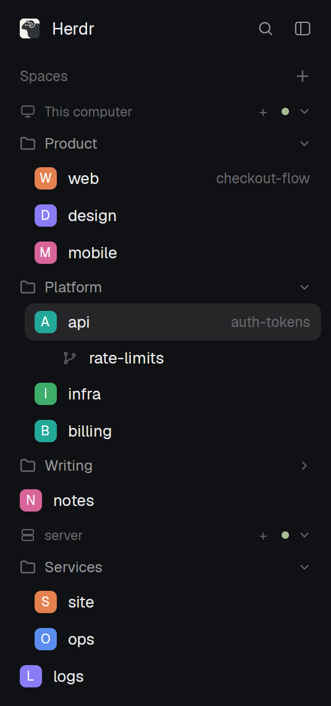
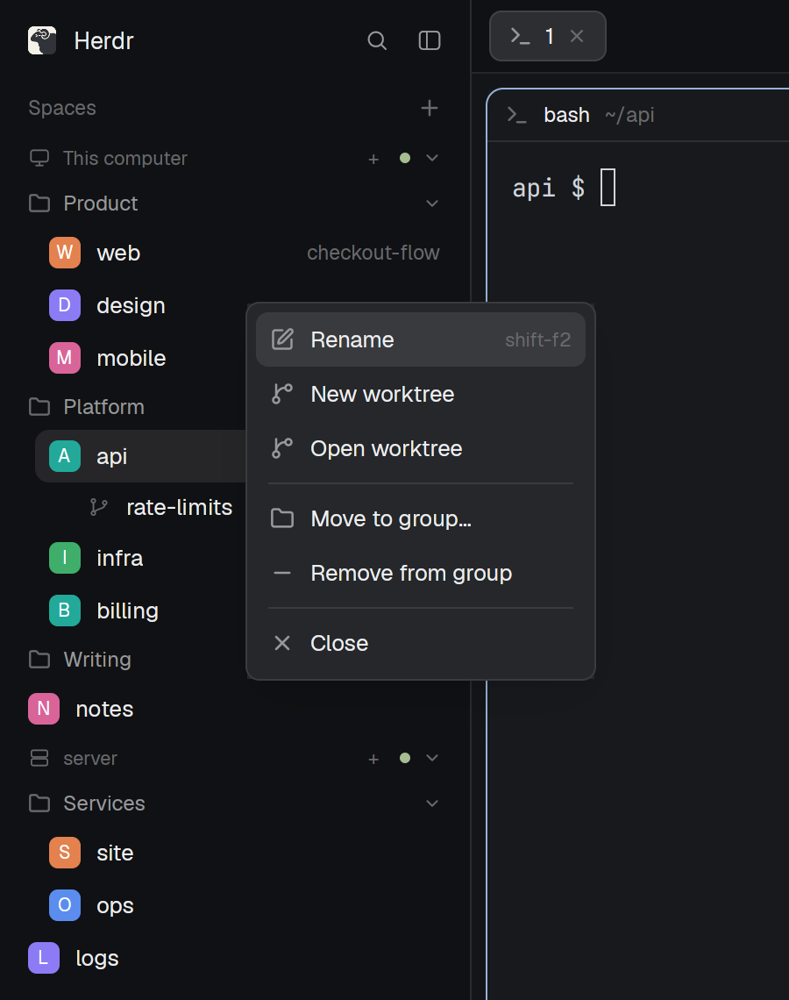
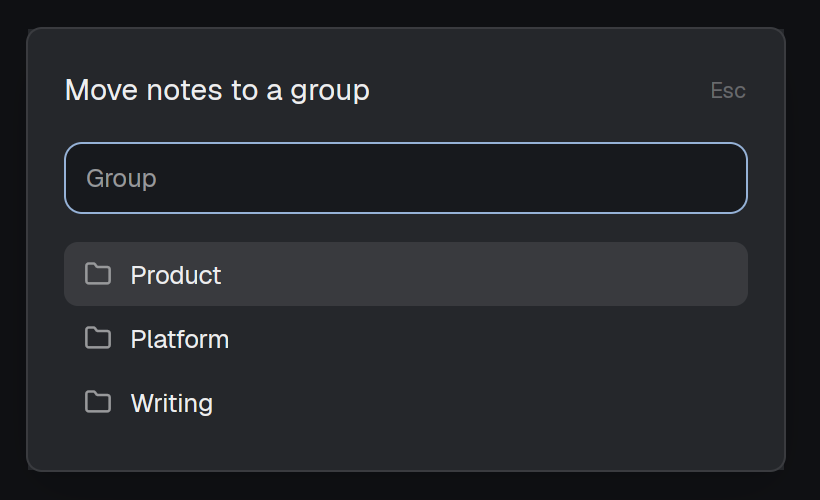

# herdr-space-groups

Group spaces by hand in the Spaces sidebar of the [Herdr app](https://herdr.dev).



The mod is the Spaces sidebar with groups added.
Groups sit inside each machine's section and fold like the machine headers, with spaces in no group listed below them.
Everything else works as in Herdr's own sidebar: switching, the space menu, drag to reorder, the collapsed rail, repo and branch hints, and worktrees under their checkout.

## Install

On the computer that runs the Herdr app:

```sh
git clone https://github.com/suppa-duppa-labs/herdr-space-groups
cp -r herdr-space-groups/mods/space-groups ~/.config/herdr-app/mods/
herdr-app check ~/.config/herdr-app/mods/space-groups
```

Then show it in a layout.
Herdr's own layouts are read-only, so if you are on one of them, run Duplicate layout from the command palette first, or:

```sh
herdr-app do layout.clone '{"name":"main","as":"my-layout"}'
```

In `~/.config/herdr-app/layouts/<your layout>.json`, change the Spaces block's `"mod"` from `"spaces"` (or a copy of it) to `"space-groups"`:

```json
{ "id": "spaces", "type": "block", "content": { "mod": "space-groups" } }
```

The window picks it up within a second.
To go back, set it to `"spaces"` again.
To update, copy the folder again.

## Use



- Right-click a space for Move to group…, which picks one of that machine's groups or makes a new one from the name you type, and Remove from group.
- Click a group's header to fold it.
  Right-click it to rename the group, or delete it, which leaves its spaces in no group.
- Drag a space onto a space in another group to move it there and to that spot, or onto a group's header to add it to that group.
- A worktree listed under its checkout goes with its checkout's group.



Groups are kept on the computer running the app, in its shared state (`shared.json`, key `space-groups`), so they survive restarts and app updates.
They hold spaces by id, which includes the machine (`server/sp1f…`).
A closed space leaves its group once its machine's spaces can be read again, so a machine that is away keeps its groups.

## Adding items to the space menu

Other mods can add items to a space's right-click menu through the shared key `space-groups.menu`.
Each mod writes its own entry, an array of items:

```js
import { shared, setShared } from "herdr";

setShared("space-groups.menu", {
  ...(shared("space-groups.menu") ?? {}),
  "my-mod": [
    { label: "Open board…", icon: "mods/my-mod/board.svg", overlay: { mod: "my-mod", kind: "dialog", width: 480 } },
  ],
});
```

- `overlay` is opened as given, with `space` (the space's id) added to its `props`.
- `spaces` shows the item only for those space ids, and `except` hides it for them.
- `icon` is optional, a path in the app's folder drawn tinted.

## Notes

- If you install it under another folder name, change `MOD` in `groups.js` to match: the menu and dialogs open as overlays of this mod.
- `sidebar.js` and `menu.js` start from Herdr's own `spaces` and `menu` mods, as Duplicate mod would, so later changes to Herdr's sidebar don't reach this one until it is updated.

## License

MIT, see [LICENSE](LICENSE).
Parts adapted from the Herdr app are under the Apache License 2.0, see [NOTICE](NOTICE).
